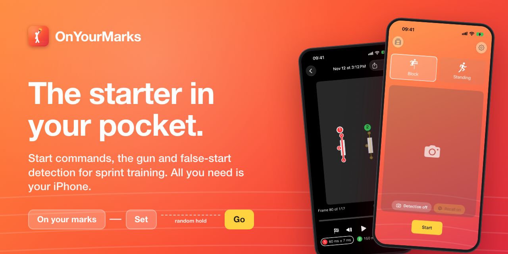
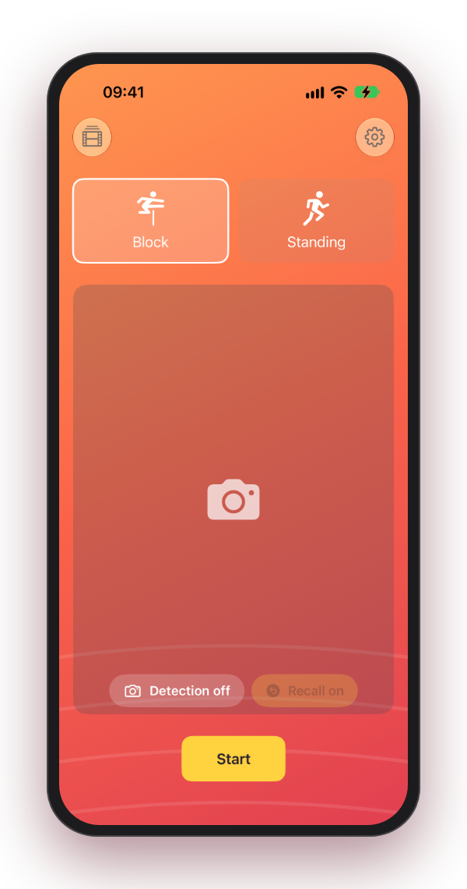
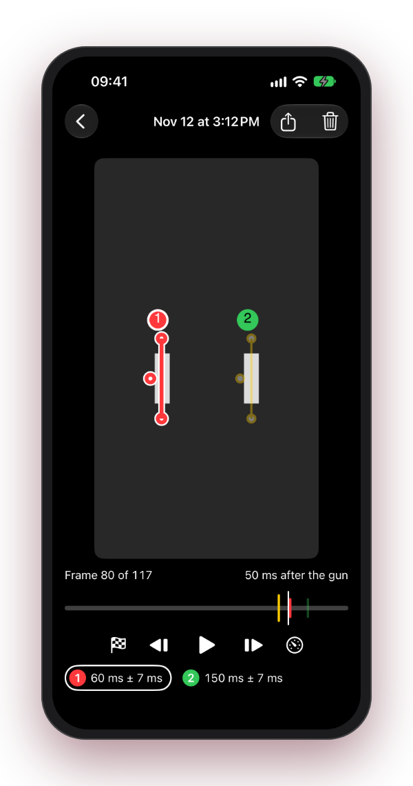
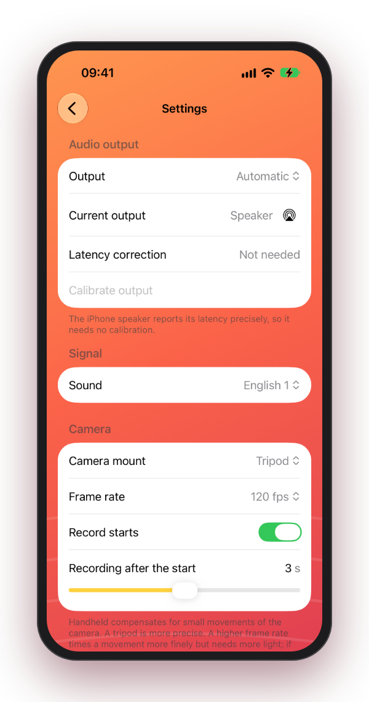

### The starter in your pocket: start commands, the gun and false-start detection for sprint training.

> [!WARNING]
> Reaction times have not been checked against an independent reference yet. Use them for training, not to settle a race.

> [!NOTE]
> The documentation is in [docs/](docs/README.md), starting with the [quick start](docs/quick-start.md).

  
  
  

## Features

| Feature | |
|---|---|
| "On your marks", "Set" and the gun, with a random hold | Yes |
| Block and standing starts | Yes |
| False-start detection with the camera, several athletes at once | Yes |
| Recall shots on a false start (can be switched off) | Yes |
| Reaction time per athlete | Yes |
| Recording and frame-by-frame review | Yes |
| Second analysis of the recorded video after the start | Yes |
| Handheld camera | Yes, less precise than a tripod |
| Bluetooth speakers | Best effort, less accurate |
| Several phones in one start | Clock synchronization only |
| Finish timing | No |

## Links

- [Quick start](docs/quick-start.md)
- [Features](docs/README.md#features)
- [Accuracy](docs/accuracy.md)
- [FAQ](docs/faq.md)
- [Developer documentation](docs/README.md#developer)

## Requirements

An iPhone with iOS 27. The app is built from source with Xcode; see [Building and testing](docs/developer/testing.md).
